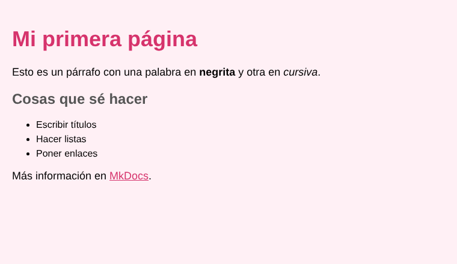

# Estilos con CSS

CSS cambia el aspecto de las etiquetas de HTML. Cada regla tiene un selector y unas propiedades:

```css
h1 {
  color: blue;
  font-size: 32px;
}

p {
  background-color: lightgray;
}
```

## Resultado

La misma página de antes, pero ahora con el CSS puesto:



## Propiedades que más uso

- `color`: color del texto
- `background-color`: color de fondo
- `font-size`: tamaño de la letra
- `margin`: espacio por fuera
- `padding`: espacio por dentro

## Enlazar el CSS

El archivo CSS se enlaza dentro del `<head>`:

```html
<link rel="stylesheet" href="estilos.css">
```

!!! example "Ejemplo"
    Con la regla de arriba, todos los títulos `<h1>` de la página salen en azul.

!!! note "Nota"
    También se puede escribir CSS dentro de la etiqueta `<style>`, pero es mejor un archivo aparte.
