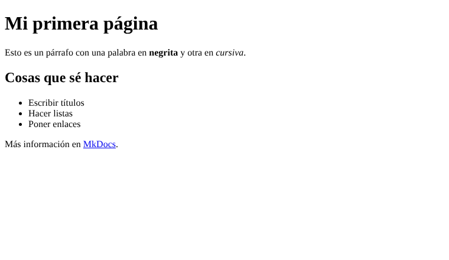

# Estructura de una página HTML

Todas las páginas HTML tienen una estructura parecida:

```html
<!DOCTYPE html>
<html lang="es">
<head>
  <meta charset="UTF-8">
  <title>Mi página</title>
</head>
<body>
  <h1>Hola mundo</h1>
</body>
</html>
```

- `<head>`: información de la página, como el título.
- `<body>`: lo que se ve en pantalla.

## Cómo se ve

Una página con título, parrafos, listas y enlaces, sin nada de CSS, se ve así:



!!! tip "Consejo"
    El archivo se guarda con la extensión `.html` y se abre con el navegador.

!!! warning "Atención"
    Hay que cerrar las etiquetas, si no la página puede verse mal.
